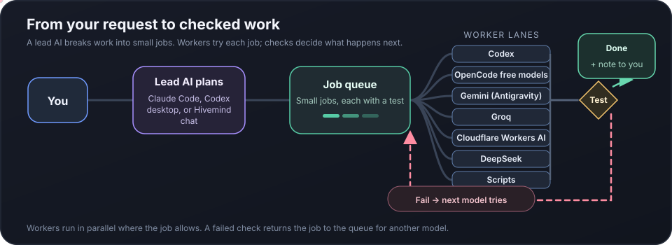
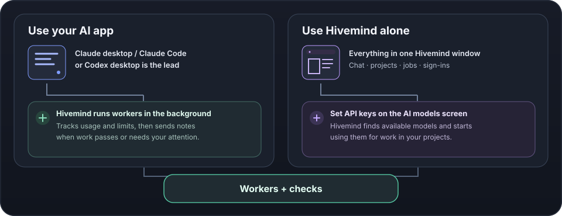
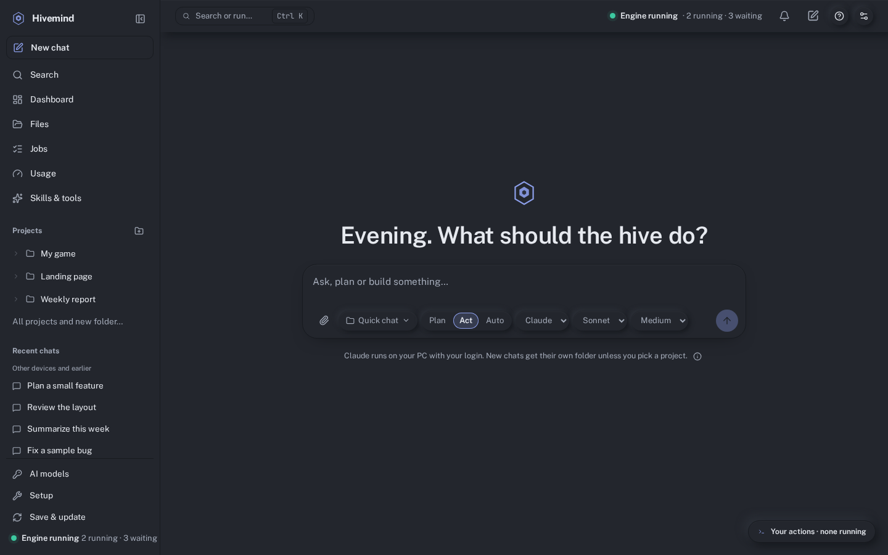
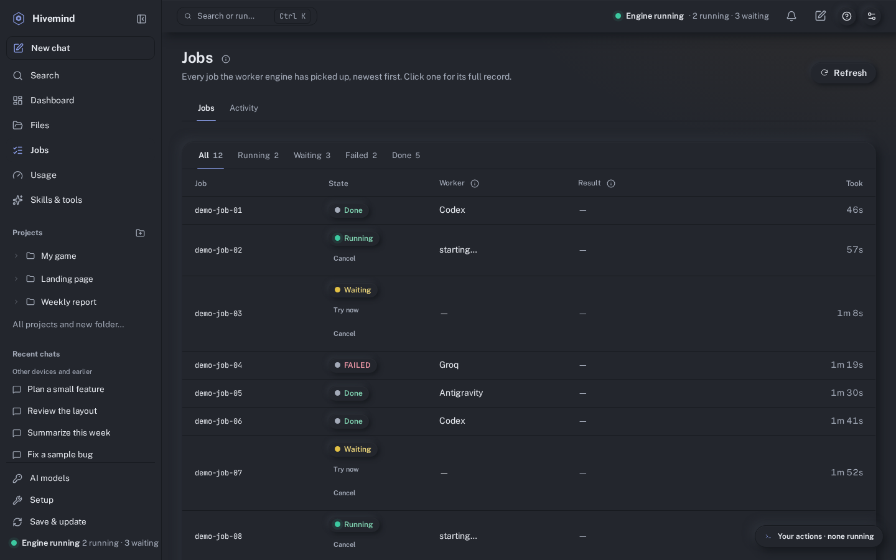

  

<h1 align="center">Hivemind Control</h1>

<b>A whole AI team on your PC, run from one window.</b> 
One lead AI plans. Free and low-cost AIs do the typing. Scripts check every result. You stay in charge.

## Two ways to use it

- **With your AI app.** Keep working in Claude desktop, Claude Code or Codex desktop as your lead. Hivemind runs the worker
  engine in the background, hands jobs to the right models, tracks limits and usage, and tells you when something needs you.
- **Hivemind alone.** Do everything in the Hivemind window: chat, projects and jobs. Sign in to providers and add API keys from
  the **AI models** screen; Hivemind finds the new models and starts using them.

## How much more you get

Compared with using Claude and Codex alone, Hivemind added **about 40% more passed jobs and about 110% more tokens of work** per
month on our test PC, at no extra cost. The extra work came from free models (OpenCode free models, Gemini, Groq and others)
that would otherwise sit unused.

| Per month (projected from 27 Oct - 19 Nov 2026) | Claude + Codex only | With Hivemind |
|---|---|---|
| Tokens processed by workers | about 170 million | about 360 million (+110%) |
| Jobs that passed their test | about 180 | about 250 (+40%) |
| Extra cost | | $0 (free tiers) |

How we measured: every worker run is logged on the PC with its provider, tokens and test result. We added up 24 days and scaled
to 30. Your numbers depend on your accounts and the kind of work. Free models fail their test more often, so passed jobs grow
less than tokens.

## Why it costs less
Premium AI time is the scarce part. Hivemind spends it on planning and judging, and hands the building to free models and plain scripts.
From our own logs, 10-19 Nov 2026 (421 jobs):

| | Jobs | Passed its check |
|---|---|---|
| Codex on a free ChatGPT sign-in | 178 | 79% |
| OpenCode free models | 67 | 52% |
| Antigravity (Gemini) | 13 | 54% |
| Script workers (git, Android builds, screenshots, files) | 81 | 78% |

A job only counts as done when its test passes; a model saying "done" is not enough. Failed tries move to the next model automatically.
A measured side-by-side against a single premium agent is in progress and will be published with its method.

## What you get
| | |
|---|---|
| **Chats and projects** | Chat with your lead AI in any project folder, plan or act, attach files; each project keeps its chats, files and tasks. |
| **The worker engine** | Jobs run in the background on the best free model for each task: building, reviews, research, image checks, image generation, quick answers. New providers you add a key for are found and used automatically. |
| **Checks that decide** | Every job carries a test. Fresh-eyes reviews check job instructions before work starts, and screenshots of every screen catch layout bugs. |
| **Usage and cost** | Limits for every provider, day-by-day tokens, cost and success rate per model, kept on your PC. |
| **AI models and setup** | One row per provider: sign in, add a key, see what it is used for. Checks with one fix button per problem. |
| **Phone access** | Use it from your phone privately through Tailscale (free). Nothing is opened to the internet. |
| **Save and update** | One click saves your work and installs new versions, with patch notes. |

## A quick tour
All screenshots use the app's sample-data mode. No real projects or files are shown.

**Home.** What is running, waiting and done, at a glance. Each job is one cell in the comb.

**Chat.** Ask your lead AI to plan or act, in any project folder. Pick the model and effort.

**Jobs.** Every background job with its worker, state and time. Retry or cancel from the row.

**Usage.** Limits left for each provider, plus tokens, cost and success rate day by day.

**AI models.** One row per provider, connected and best first. Sign in or add a key in one click.

**Light theme.** Every screen has a light and a dark theme.

## How a job runs
1. You ask in a chat. The lead AI turns the request into small jobs, each with a test.
2. Each job goes to the best free or low-cost model for that kind of work.
3. The test runs. If it fails, the job moves to the next model on its own.
4. Only passed work counts as done. You see every step in Jobs and get a note when something needs you.

## Your data stays yours
- Everything runs on your own computer. There is no Hivemind server.
- Keys are stored on your PC only, never in chats, files or logs.
- Usage history is kept locally and is never uploaded.
- Phone access goes through your own private Tailscale network.

## Case study: one UI rebuild, start to finish
The Usage, AI models and Jobs screens were rebuilt in one session: 6 planned jobs, 13 runs and 14 model tries in 52 minutes of
worker time. 7 runs passed on the first check; the rest were caught by the checks (wrong expectations, a broken plan file) and
re-run, with no bad change shipped. The lead AI wrote the plan and reviewed results; it typed almost none of the code.

## Get it
The first public download is on its way. Click **Watch -> Custom -> Releases** at the top of this page to hear when it is out.
It will be one installer: run it, and the app checks and sets up everything else for you, with progress shown.

Before then, see what you will need and what has changed:

- [Requirements](docs/REQUIREMENTS.md) · [Questions and fixes](docs/FAQ.md) · [What's new](docs/CHANGELOG.md)

## Licence
Free for personal and other noncommercial use under the PolyForm Noncommercial License 1.0.0 ([LICENSE](LICENSE)).
Copyright (c) 2026 Sakib Hasan.
