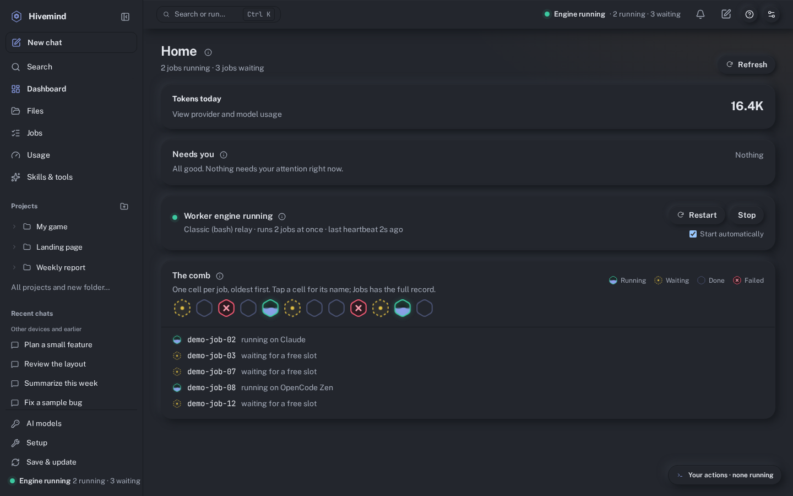
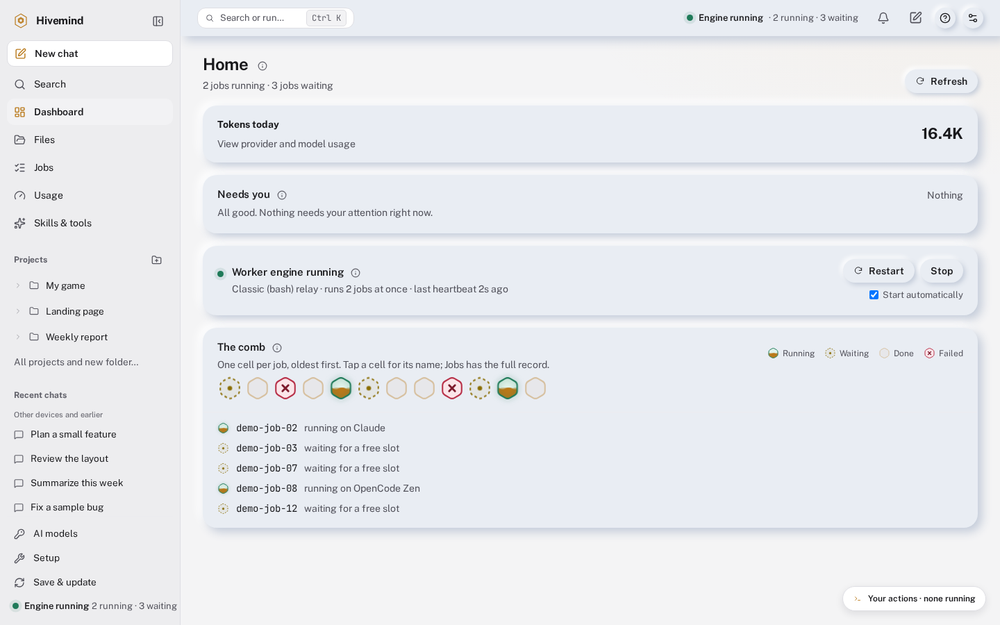
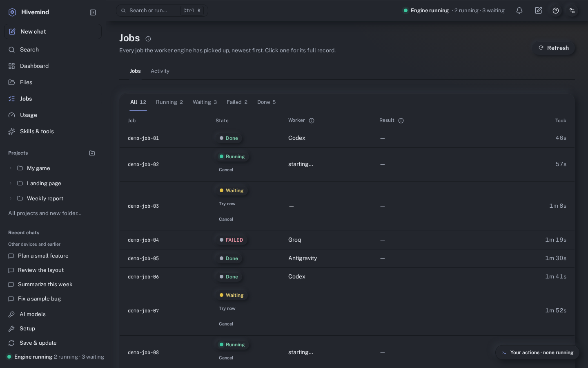
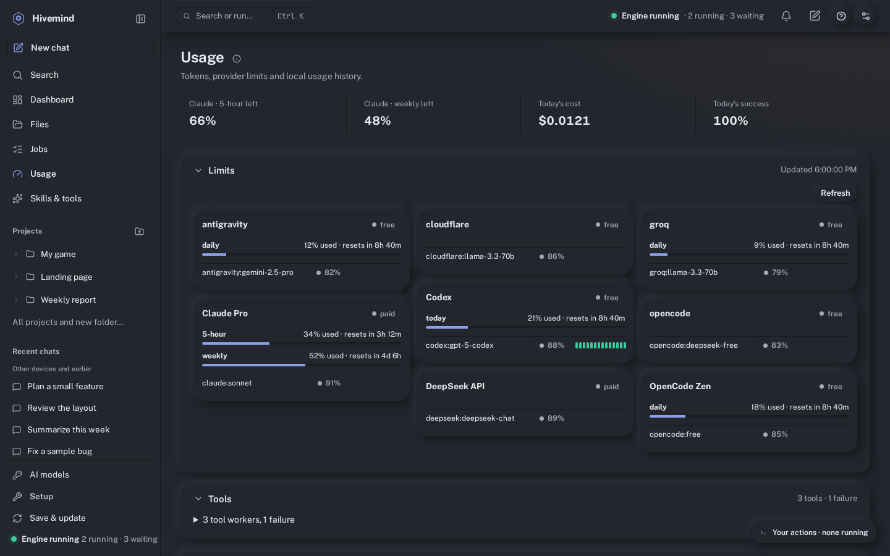
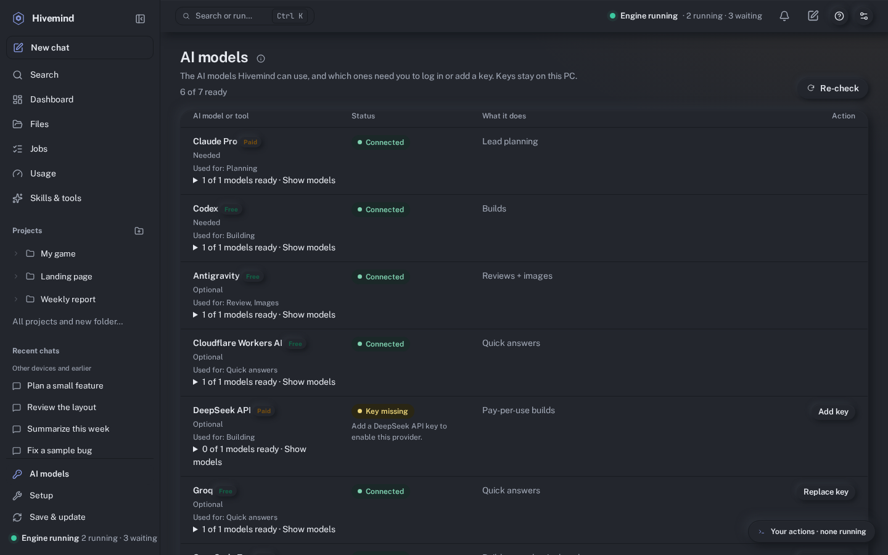
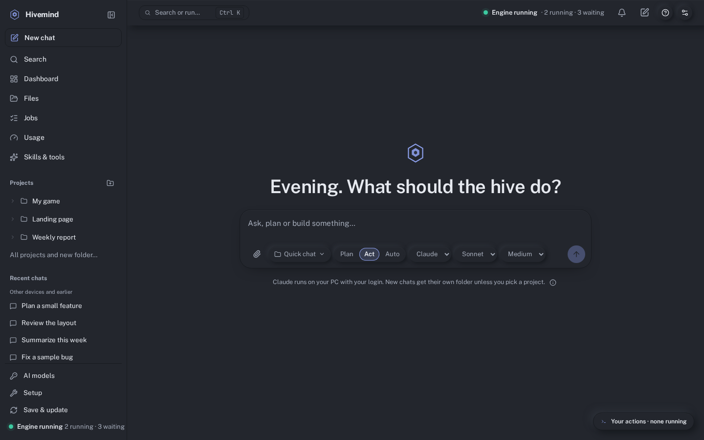

# Screenshots

All screenshots use the app's sample-data mode. No real projects, folders or files are shown.

## Home
One window for the whole team: what is running, waiting and done, plus quick actions.

## Jobs
Every job with its worker, state and time. Retry or cancel from the same row.

## Usage
Cost, success rate and remaining limits for each provider, day by day.

## AI models
Providers grouped in one list, connected and best ones first, with one line for anything that needs attention.

## Chat
Ask the team, pick plan or act mode, and watch it think.

